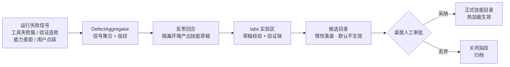
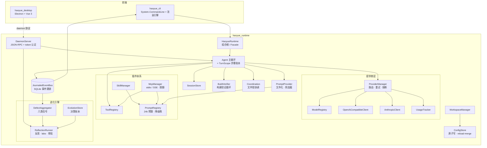

<p align="center">
  
</p>

<h1 align="center">Haoyue（浩玥）</h1>

<div align="center">

[](https://opensource.org/licenses/MIT)
[](https://dotnet.microsoft.com/)
[](https://www.npmjs.com/package/haoyue-cli)
[](https://github.com/Laogaodhck/haoyue/stargazers)
[](https://github.com/Laogaodhck/haoyue/network/members)
[](https://github.com/Laogaodhck/haoyue/issues)

**一个会自我反思的本地优先 AI Agent 平台**

Haoyue 是基于 .NET 10 构建的高性能 AI Agent，以事件溯源运行时为核心，提供终端 CLI 与桌面应用双前端。除完整的 Agent 能力（多提供商、工具执行、技能、MCP、知识库）外，Haoyue 内置了少见的**元认知层**：自动聚合失败信号、驱动反思回合产出技能草稿、经人工审批后热加载生效——Agent 在使用中持续变好。

[快速开始](#-快速开始) •
[功能特性](#-功能特性) •
[架构设计](#️-架构设计) •
[进化引擎](#-进化引擎) •
[更新日志](CHANGELOG.md) •
[English](README_EN.md)

</div>

---

## ✨ 功能特性

### 🏗️ Runtime First 架构

- **清洁架构**：`haoyue_runtime` 为核心，CLI 与桌面端是它的两个前端，关注点严格分离
- **常驻守护进程**：daemon 经 Named Pipe / Unix Socket 暴露 JSON-RPC，桌面端与 CLI 共享同一运行时、HTTP 连接池、熔断器与文件锁协调器
- **广播与可观测**：14 个流式事件（含 `warning`、`approval_request`）、6 个终态事件、9 个广播事件（`task.updated`、`mcp.updated`、`schedule.updated` / `schedule.upcoming`、`evolution.reflected`、`memory.consolidated`、`turn.interrupted`、`model.load.progress`、`team.run.updated`）；广播为每个连接复制一份 `details`，单个客户端写失败只记日志、不掀事件泵。桌面端把自管 Runtime 的全部输出与退出码落盘 `<userData>/logs/daemon.log`——「没有回复」先看这个文件，诊断链路见 [回合无输出诊断报告](haoyue_doc/本地模型回合无输出诊断与修复-2026-10-14.md)；慢消费者不再丢失流式内容：订阅队列饱和时文本 / 思考增量就地合并、其余事件按序补齐，内存仍有上界
- **回合结果诚实可判定**：流式中断（首 token 后无候选）、拒绝回答、连续空返回都不再误报「任务完成」——消息带 `finishReason`，半截回答在历史里与完整回答可区分；策略拒绝与内部告警（上下文压缩失败等）经 warning 事件入契约并直达桌面，「为什么被拦」用户看得见
- **per-turn 预算闸门**：每个交互回合有墙钟与 token 双重预算（墙钟按 ReasoningLevel 映射），超限即收束；用量记录带真实成本估算
- **工具调用能力零流量探测**：提供商未声明 `toolCalling` 能力、本地客户端或真实请求被 tools 相关错误拒绝时，当回合不再注入全量工具 schema（省 token 且避免本地模型空谈），拒绝记录进缓存后续回合直接跳过
- **主动上下文压缩**：投影 token 接近窗口水位（85%）即提前压缩，不再等超限当回合抛错
- **安全接入**：启动时生成随机握手 token（`~/.haoyue/daemon.token`，仅当前用户可读），客户端首条消息必须携带 token 认证，未认证连接立即拒绝
- **局域网接入（可选）**：本机 Runtime 可在「设置 → 局域网连接」开启局域网监听（默认关闭，端口 47615），同网段另一台桌面可把 Runtime 目标切到这台机器；握手改走一次性 nonce + HMAC-SHA256 挑战应答，令牌不上线、不能跨连接重放。并发上限 16，认证失败延迟断开；`daemon.lan.get` / `daemon.lan.set` 热生效，改地址与端口无需重启。传输仍是明文 TCP（令牌除外），仅建议用于可信局域网。远程模式下工作区选择、附件与项目终端仍作用于本机，会话与工具运行在远端
- **事件溯源**：关键事件（轮次、工具调用、用量、诊断、进化信号）写入 SQLite 事件日志（保留 5000 条），`events.recent` 可查询重放，重启不丢失
- **四层扩展**：Tools、Skills、Prompts、MCP（Model Context Protocol）插件机制

### 🤖 多提供商与模型

- **OpenAI 兼容 / Anthropic / 国内云厂商**：OpenAI、Anthropic，以及阿里云百炼、火山方舟、腾讯云混元、百度千帆、智谱 GLM、DeepSeek 等预设一键接入
- **cURL / Python 一键导入**：新增提供商时直接粘贴调用片段，自动识别 API 地址、Bearer Key 与模型 ID（支持 OpenAI、requests、Anthropic 等常见写法），识别结果仍走加密密钥与 OpenAI 兼容链路
- **本地模型**：Ollama、LM Studio，或直接进程内运行 GGUF 模型（无需任何服务器），支持 GPU 层卸载、MoE 专家权重钉 CPU、KV 缓存量化、Flash Attention 与跨请求 KV 前缀复用；加载失败自动重试（GPU 卸载失败自动降级 CPU），加载完成后自动执行小上下文推理自检——权重损坏或上下文放不下在加载期即暴露；CUDA 12 后端实测解码提速 **11 倍**（7.6 → 84.9 tok/s）；多模型 LRU 驻留（默认 2 个，嵌入/聊天交替零重载，实测 **6.4~6.9×** 加速）、daemon 启动后台预热、加载进度实时广播（阶段 + ETA）、header/mmproj 元数据缓存（换文件自动失效）、空闲权重自动回收（默认 20 分钟）、备用模型回退与 GGUF 版本 / ABI 兼容性早期诊断——详见 [本地模型加载优化报告](haoyue_doc/本地模型加载优化报告-2026-10-14.md)；**Windows 安装包 / 便携版默认内置 CUDA12 后端**（`build.py` 自动以 `-p:LlamaBackend=Cuda12` 发布，无 GPU 自动降级 CPU），8B R1 蒸馏模型实测 GPU 解码约 39 tok/s（对比 CPU 约 5.4 tok/s，一次问答从约 51s 降到约 11s）；无思考模式下强制收束 R1 蒸馏模型的自发思考链（思考段字符上限 + 注入收束标记），回答不再被不可见思考吃空
- **本地多模态视觉**：GGUF 配套 mmproj 权重自动发现，本地模型可直接"看"对话中的图片与工具截图——带图请求自动降级 CPU 上下文规避上游 CUDA 慢路径，文本轮保持 GPU 全速
- **智能路由**：快速、均衡、质量、经济、离线多种策略，自动重试、指数退避与熔断器故障转移
- **模型切换上下文连通**：会话中随时切换模型（本地 ↔ 云端、不同提供商），历史消息完整延续——助手消息带来源模型标识、思考段独立存储不污染正文，新模型按自身窗口自动适配；本地各模型独立 KV 缓存互不串扰，故障转移复用同一历史（Agent 层回归测试固化）
- **用量统计**：Token 计数、成本与模型分布，桌面端图表可视化

### 🛠️ 工具与技能生态

- **内置工具**：文件读/写/编辑（diff 精确应用）、grep/glob、bash、持久会话终端（terminal）、无头浏览器（browser，复用系统 Edge/Chrome）、网页搜索与抓取、任务规划、屏幕捕获
- **文档创作链**：`doc_render` 工具把 Markdown 渲染为 docx / xlsx / pptx 产物（标题/列表/引用样式完整映射、管道表格落为真实电子表格行列、H1 分页出幻灯片），复用内置 doc_toolkit（纯 Python、离线），产物统一落 `.haoyue/outputs/documents/`；Python 运行时不可用时工具自动隐藏。配套官方技能：报告成文（Word）、数据表生成（Excel）、演示稿生成（PPT）
- **MCP**：stdio 与 SSE 传输，自动发现工具/提示/资源；提示注入有每服务器 24 个、总量 48 个的限额，超限原因在 MCP 状态中可见
- **连接器生态**：连接器包规范（`connectors/schema/connector.schema.json`）+ 首批 12 个官方连接器——浏览器（Playwright）、Git、GitHub、GitHub CLI（gh）、邮箱（IMAP/SMTP）、日历 ICS、RSS、剪贴板、Notion、SQLite、HTTP API 通用器、系统通知；本地免依赖部分由随包分发的单文件本地 MCP 服务器承载（纯 Python 标准库、零外部依赖），secret 配置项加密落盘。`haoyue connectors list / install / uninstall` 两步完成「发现 → 可用」，规范见 [connectors README](connectors/README.md)；安装后随包迁移仍可用——内置本地服务器路径失效时连接前自动重解析并持久化（自愈），无需手动重装。GitHub CLI 连接器复用本机已登录的 `gh`，暴露 11 个白名单工具——8 个只读（`gh_auth_status` / `gh_repo_view` / `gh_repo_list` / `gh_issue_list` / `gh_issue_view` / `gh_pr_list` / `gh_pr_view` / `gh_pr_checks`）与 3 个显式写（`gh_issue_create` / `gh_issue_comment` / `gh_pr_create`）；参数按正则 / 枚举 / 长度校验并拒绝 `-` 开头的选项注入，全部以参数列表交给子进程、不经 shell，不提供任意 `gh api` 透传，复用 gh 自身凭据且不读取 / 不落盘 / 不输出 token（输出统一脱敏与截断）。工具仍走既有权限阶梯：全局硬禁用 > 工作区 `disabledTools` > 工作区 `allowedTools` > 角色预置 > 团体成员清单 > 单次调用，逐层收窄、deny 优先，越权只返回「该工具不可用」并记入钩子台账。设置 → 扩展的 github-cli 卡片展示本机 gh 版本、登录账号与可用性，未安装 / 未登录时提供安装链接、`gh auth login` 复制与官方登录文档。
- **技能系统**：目录式技能（`skill.yaml` + `prompt.txt`），manifest v2 支持触发关键词、工具白名单与参数收集；技能变更后扫描热加载，无需重启；**30 个官方技能**随目录分发（深度研究、周报、数据清洗、截图 OCR 入库、依赖审计、竞品扫描、文档三件套等），桌面端技能市场一键安装
- **多模态输出**：`image_generate` 图像生成（OpenAI 兼容 images/generations 端点，b64/url 双通道）、`image_edit` 图片编辑（同端点多传参考图，本地图转 `data:image/<fmt>;base64,<...>` data URI，支持风格迁移/元素替换/局部修改/消除）、`video_generate` 视频生成（seedance 同源异步任务——创建 → 轮询 → 下载 MP4，超时交 `video_status` 续查；单回合默认等待 120s），产物分别落 `.haoyue/outputs/images/` 与 `.haoyue/outputs/videos/` 并可回灌视觉核验链；未配置图像模型时图像工具自动隐藏、未配置 `videoGen.model` 时视频工具自动隐藏（本地扩散/视频模型不在进程内推理能力内，可接 ComfyUI/SD 兼容网关，见 [部署与隔离 Runbook](haoyue_doc/runbooks/deployment-isolation.md)）
- **语音输入与朗读**：`speech_to_text` 语音转写与 `text_to_speech` 语音合成（豆包语音同源，火山 openspeech——ASR 录音文件极速版 `volc.bigasr.auc_turbo`、大模型语音合成 seed-tts-2.0），桌面端输入框一键录音转写、消息朗读按钮合成播放，视频/音频产物在消息流内联播放；`speech.apiKey`（支持 `secret:` 加密引用）未配置时两个语音工具自动隐藏
- **允许的网站（外部网站访问白名单）**：`web.allowedSites` 配置后 `web_fetch` 仅能抓取列表中的站点与 localhost（127.x / ::1 始终可用），支持 `https://*.example.com` 子域通配（根域需单独添加）；运行时强制、每次执行现读配置，桌面端「设置 → 允许的网站」卡片可视化增删（RPC `web.allowedGet` / `web.allowedSet`），变更立即生效无需重启。**留空时 `web_fetch` 视为未启用白名单（不限制外部站点），桌面端内置浏览器则默认只允许 localhost**——承载任意站点脚本的浏览器视图不会因留空而对全网敞开，外网站点需显式加入

### 🧠 知识库与记忆

- **自动沉淀**：对话中自动保存 / 检索 / 遗忘知识
- **高容错检索**：同义词扩展、全半角归一化、CJK 二元分词与编辑距离兜底——错别字、中英混排也能命中；支持自定义同义词表热重载
- **语义检索层**：配置 embedding 能力模型后，知识检索自动升级为「词法 + 余弦相似度」混合排序（0.6/0.4 融合），向量按 (工作区, 词条, 模型) 缓存于 SQLite；任一环节失败自动整体退回纯词法方案——语义是增强，不是依赖。双通道接入：HTTP 走 OpenAI 兼容 /embeddings（Ollama / LM Studio / 云端均可）；本地 GGUF 嵌入模型（`capabilities.embedding = true`）直接进程内推理，零网络依赖
- **规则与记忆**：AGENTS.md 文件规则与结构化规则并存——「设置 → 规则与记忆」可按全局 / 项目作用域增删改、启停、调整优先级；同标题规则在全局与项目重复时给出冲突提示，并可显式选择「项目胜出 / 全局胜出 / 合并到项目」，解决结果与操作者写入命中记录；规则每回合重读，保存后下一回合生效，会话系统提示里能看到本次生效的规则清单
- **记忆可查看可纠错**：事实库支持列表 / 新增 / 编辑 / 删除 / 置顶 / 撤销仲裁 / 确认自动固化（`facts.list/add/update/delete/pin/restore/confirm`），置顶事实优先注入；仲裁结果（保留哪条、取代了哪些）在界面可见，误判可一键撤销并形成反向仲裁；规则命中、事实与配置均按工作区隔离，跨项目不可读写
- **项目事实层**：`fact_save` 沉淀带来源、置信度、可选 TTL 的结构化短句事实（`.haoyue/facts.json`），自动注入后续回合并标注"待确认"，到期自动失效——介于 MEMORY.md 与知识库之间的中间记忆层；`fact_search` 按主题检索、`fact_forget` 撤销错误事实；同主题新事实可显式 `supersedes` 或自动仲裁（词条 Jaccard ≥ 0.45 且置信度不低于旧），被取代事实退出注入但保留供审计，冲突事实注入时带「采信前先向用户确认」标注
- **记忆固化（ConsolidationRunner）**：daemon 每 6 小时把近期会话经验自动提炼为项目事实（隔离回合 + 幂等去重 + 冲突仲裁兜底，模型只判断"什么值得记住"），有实际执行步骤的成功回合结束给一条轻提示——「经历 → 记忆」不再依赖模型当回合自觉；`agent.memoryConsolidationEnabled` 可关闭

### 🤝 多代理协作

- **单任务委派**：`delegate_task` 在独立上下文与独立会话中运行子代理，深度由 `agent.delegationMaxDepth`（默认 1，上限 4）控制
- **并行 fan-out**：`delegate_tasks` 把 2-6 个独立子任务并行派发给多个子代理，一次返回按任务分节的聚合报告；并行子代理的文件写入经统一文件锁协调，且不得再委派
- **角色化子代理**：委派时传 `role=researcher / implementer / reviewer` 即注入角色纪律提示词并收敛工具白名单（研究员/评审员只读、工具视图白名单强制），所有角色返回统一的四段汇报模板（结论/关键发现/涉及文件/风险），多代理聚合稳定可解析——见 [角色化 Runbook](haoyue_doc/runbooks/delegation-roles.md)
- **自定义子智能体（Markdown）**：`~/.haoyue/agents/*.md`（用户级）与 `<项目>/.haoyue/agents/*.md`（项目级）定义自己的子智能体——frontmatter 声明名称、描述、模型与工具白名单，正文即工作指令；项目级覆盖用户级、同名覆盖内置预设，保存后下一次委派立即生效，指定模型仅作用于该子智能体；桌面「设置 → 智能体」可直接增删改
- **智能体团体**：「设置 → 智能体团体」按工作区管理团队（新建 / 编辑 / 复制 / 删除 / 启用），成员可配角色、职责、模型、工具白名单与专家；支持顺序执行、并行执行、主管调度、评审制四种协作模式，可设轮次上限、整体超时、成员重试与失败策略（停止 / 跳过继续 / 降级汇总）。`team.run` 受理即返回 runId，进度经 `team.run.updated` 广播，任意阶段可 `team.cancel` 并收敛为 cancelled；运行轨迹（成员分工、工具调用、耗时、失败原因）可回看，最终结果汇总为一条普通助手消息；daemon 启动时把残留 running 的运行对账为 interrupted 并清理临时产物

### 🔒 可靠性与安全（元数据层之下）

- **工具执行强制策略闸门**：每次工具调用在参数解析后、执行前经 `ToolExecutionPolicy` 强制评估（模型无法绕过）——用户 allow/deny 规则 + 内置 bash 高危守卫（根目录递归删除、磁盘擦除、fork 炸弹、curl|sh 远程执行、卷影删除等），命中即拒绝并落审计事件；`agent.toolPolicy` 配置
- **工具细粒度权限**：工作区配置新增 `allowedTools` 与 `allowToolFallbackToGlobal`，裁决顺序为全局硬禁用 > 工作区禁用 `disabledTools` > 工作区白名单 > 角色预置 > 团体成员清单 > 单次调用清单，逐层只收窄且 deny 优先；支持 `server/tool`、`server/*`、`*/tool` 等通配符（映射到 MCP 本地名 `mcp__server__tool`）。越权工具降级为「该工具不可用」并记入钩子台账，回合继续而不会整体失败；角色 / 成员清单把工具裁空时默认保持空集（fail-closed），仅在显式开启降级开关后回退到工作区清单。桌面端「设置 → 工具权限」可编辑白名单、校验模式格式并切换降级开关
- **审批决策留痕**：每次审批（内置高危守卫、工具同意、风险分级）都记录一条 `ApprovalDecisionEvent` 到事件台账——工具名、参数摘要、原因、工作区、回合 id、操作者与结果（批准 / 拒绝 / 超时 / 取消），可经 `events.recent` 回放审计；事件裁剪时审批记录单独保留最近 2000 条，不被普通事件挤出
- **定时任务接入审批通道**：定时任务与手动回合共用同一交互式审批注册表，高风险工具不再被静默放行；`approval_request` 经广播送达已连接客户端，无人响应按 120 秒超时拒绝（失败关闭）；每次定时运行以 `schedule:<taskId>:<runId>` 标识写入审计，审批结果可归到具体计划任务
- **凭证全链路不出明文**：provider API Key 解密后不再经 RPC 回传（只回「已配置」标记，保存按「未改动即不覆盖」语义）；凭证加密存储覆盖 Windows DPAPI、Linux keyring/文件回退与 **macOS 登录 Keychain**（Security framework 原生互操作），接不上 Keychain 时显式告警而非静默明文；CLI 的 `provider add/edit` 支持 `--api-key-stdin`、`connectors install --set KEY=-` 从标准输入读值，密钥可以不进 shell 历史与进程列表
- **日志与 IPC 出口收口**：daemon stdout/stderr 落盘前按整行拼接后脱敏（被分块切断的 `Authorization` / `api_key` 同样识别），诊断包与 UI 出口二次脱敏；桌面端所有 IPC 通道只接受主窗口顶层 frame，路径参数必须是绝对路径
- **读工具同源边界**：read_file / grep / list / search 与写侧同一工作区围栏，越界读取需 `agent.extraReadableRoots` 显式放行；密钥材料名单（SSH 私钥、`.aws`/`.gnupg`/`.kube` 等凭证目录、`secrets.json`、`.netrc`、`.env*`、`.pem/.key` 等）与审计目录一律拒绝——凭证内容不会随工具结果静默进上下文；围栏按真实路径判定，符号链接 / junction 逐段解析后再比较，链接链无法解析时按越界拒绝
- **工作区信任门禁**：工作区的 `.haoyue/config.json` 与 `mcp/servers.json` 可携带自动执行命令（MCP stdio、verify），因此未受信工作区加载时整体忽略这两份配置——克隆来的仓库不能靠「打开一次」取得执行权；信任清单存于 `~/.haoyue/trusted-workspaces.json`，经 `workspace.trust` / `workspace.untrust` 显式放行或收回，清单损坏一律按「无受信工作区」处理（失败方向收紧）
- **computer_exec 纳入守卫与审计**：内置高危守卫按「命令内容 + 执行类工具」判定（不再只匹配工具名 `bash`），`computer_exec` 落与 bash 同构的审计记录
- **审计防清与脱敏**：审计命令入档前经统一 Redactor 脱敏（Authorization 头等凭证原文不进档），审计文件 8 MiB 水位自动轮转不再无限增长；审计目录对文件工具只读（bash 重定向仍绕得过，已如实标注）
- **bash 命令审计**：每条执行的命令按内容前置风险分级（low/medium/high，含分级理由），完整记录（命令、目录、风险、结果、耗时）追加写入工作区 `.haoyue/audit/bash.jsonl`，永不轮转截断，可随时回溯追责
- **进程级沙箱（Windows Job Object）**：`agent.bashSandbox.enabled` 启用后，bash 命令整棵子进程树进入内核强制围栏——内存上限（默认 2GB/进程）、活动进程数上限（默认 256）、UI 限制（剪贴板/系统参数/显示设置/关机/桌面切换），kill-on-close 保证超时命令不留孤儿进程；网络隔离不在 Job Object 能力内，审计记录带沙箱标记——网络面由部署环境收口，方案见 [部署与隔离 Runbook](haoyue_doc/runbooks/deployment-isolation.md)（代理白名单 / 防火墙按程序阻断 / 容器化），自备 GGUF（含嵌入模型注册）同见该手册第 3 节
- **原子写**：配置与状态写入走「同目录临时文件 + 原子替换」，崩溃不产生半截文件；保存前做字段级 reload-merge，多端并发只保留各自的改动
- **单写者收敛**：CLI 的配置写操作自动委托给在线 daemon（`config.save`），离线才回退本地——彻底消除多写点竞争
- **提示预算**：上下文注入总量超 24k token 时按降级秩逆序丢弃（知识库 → 技能正文 → MCP → 目录/记忆），System/Developer 消息永不丢弃，丢弃动作在会话中明示
- **回合回滚（TurnScope）**：每个回合维护步骤账本与补偿栈，`write`/`edit` 的文件变更可一键撤销（`agent.undo`）；桌面端回合完成后出现撤销横幅；daemon 崩溃后启动对账，提示未完成回合的可恢复文件
- **回合级失败工具隔离**：同一（工具，参数签名）失败达到换策略阈值后，该工具在本回合剩余时间内直接拒绝执行——把"摆烂重试同一命令"的最坏消耗从 MaxSteps 全烧压到阈值即刹车（硬动作，模型无法绕过）
- **bash 进程树治理**：默认路径自托管进程执行——Windows kill-on-close Job / Unix setsid 进程组整组 SIGKILL，超时不留孤儿进程；超时前已产生的输出回传模型而非整体丢弃
- **工具输出尾部优先截断**：非零退出码 / 超时的输出按 head+tail 折叠保留（构建与测试日志的失败摘要、exit code、统计几乎总在尾部），成功输出保持头截断
- **token 估算实测校准**：per-model EWMA 校准系数（钳制 0.5~2.5）随每次请求回写，上下文预算按该模型实测口径收敛，不再系统性高估 / 低估
- **视觉历史跨回合治理**：仅保留最近 6 条含图消息 + SHA256 内容去重 + 图片 token 双预算，图片不再跨回合重复上传
- **会话保留策略**：过期会话自动归档、无引用孤儿图片清理、每日至多一次 VACUUM（`agent.sessionRetentionDays`，默认 90，0 = 关闭）

### 📋 后台任务队列

- **长任务转后台**：daemon RPC `task.start` 提交完整 agent 回合后台执行（并发上限 4，硬超时保护），`task.get` / `task.list` / `task.cancel` 管理任务；终态经 `task.updated` 广播，会话持久化、进度可用 `events.recent` 重放——前端断开重连不丢进度；排队中与运行中均可取消，取消后终态统一收敛为 cancelled，不会误释放并发槽；桌面端右栏「后台任务」页签是该链路的完整界面（派发 / 进度 / 取消 / 跳回会话）
- **项目任务目录**：项目内发起的后台任务 / 定时任务在项目根下建立独立目录 `.haoyue/tasks/<taskId>/`，产物写入其 `outputs/`；目录名可枚举、可清理，创建前后都经 PathGuard 按真实路径校验（含符号链接 / junction），无法确认在项目内时拒绝受理，绝不静默写回全局目录；无项目归属的全局任务保持原落点
- **侧边栏项目任务**：项目分区把任务挂在项目节点下——可展开（折叠状态持久化），任务行显示状态徽标（排队 / 运行中 / 完成 / 失败 / 已取消）与最近时间，运行中可一键取消（后台任务走 `task.cancel`、普通回合走 `agent.cancel`），项目行内 `+` 直接新建任务；上次选中的会话在重启后恢复，存储值失效时回退最近更新
- **官方嵌入 SDK**：`@haoyue/daemon-client`（TypeScript）由 `contracts/daemon-contract.json` 单源生成（`python tools/generate_ts_sdk.py`），154 个 RPC 方法全覆盖、按类别类型化方法桩、token 握手与管道/socket 端点自动发现；安装到首回合 ≤10 行代码，`--check` 模式可校验产物与契约一致（该自检已接入 CI dotnet job）——见 [SDK README](sdks/typescript/README.md)

### 🖱️ Computer Use（电脑操作智能体）

- **完整 observe → act → verify 闭环**：`computer` 工具支持 18 种动作（鼠标移动/点击/拖拽、键盘输入、窗口管理、滚动等），每步自动截图回传模型核验结果
- **云端与本地模型都能"看屏幕"**：云视觉模型直接解析截图；本地 GGUF 模型经 mmproj 多模态接入同样可读图操作，不再只能靠无障碍文本盲操作
- **坐标自校准**：CoordinateMapper 屏幕标定 + `cursor_position` 自校准，DriverFaultSandbox 驱动容错，单回合 30 步上限兜底
- **系统操控子系统（SystemControl）**：`computer_exec`（跨平台 shell 解析——`auto` 按 OS 自动选 PowerShell/bash，`cmd` 仅 Windows、`bash` 仅 POSIX，POSIX 上的 powershell 需 pwsh；Python 检测与 sysinfo 同源：配置路径 → PATH → py 启动器/常见安装目录，并探测版本后缓存）+ `computer_scan`（硬件设备与文件夹结构扫描，按扫描结果定位后续操作）+ `computer_sysinfo`（系统配置、设置项与运行进程读取，含平台标识、shell 环境与 Python 版本报告）+ `computer_browser_repair`（浏览器主页劫持检测与自动修复——检测策略注册表/IE 起始页/Preferences JSON/Firefox prefs.js/快捷方式五类劫持源，修复前自动备份可回滚）
- **OS 自动识别与命令方言精准化**：运行时自动判定 Windows / Linux / macOS，模型无需猜测——`computer_exec` 对不支持的 kind 报出精确错误（指明当前 OS 与应改用的 kind），超时清树按平台选择 taskkill /T 或 entireProcessTree kill；`computer_sysinfo` 先行报告平台与 Python 版本，让后续命令直接用对方言编写
- **跨平台自动适配**：系统操控按 Windows / Linux 自动选择适配器（CIM 查询、注册表修复 vs /proc、lscpu、/etc 策略文件），权限不足的操作按失败项报告并给出提权指引，而非整体失败
- **默认休眠**：`computerUse.enabled` 默认关闭，开启需在桌面端设置中显式打开，并伴随全屏光晕提示；`systemControlEnabled` 可单独关闭系统操控而不影响鼠标键盘操控

### 🖥️ 桌面应用

- **三栏信息架构**：左栏常驻（会话 / 项目 / 时间视图，主入口标明「当前项目 / 全局」作用域），中栏对话流，右栏工作区（变更、后台任务、内置浏览器、计划任务）；设置、知识库、扩展、计划任务、归档均为右栏同级视图而非独立整页，前进 / 后退走浏览器式历史栈
- **IDE 式工作台界面**：Electron + Vue 3 + TypeScript，扁平细边三栏、紧凑行高与等宽元信息；对话采用 Agent 转录样式（消息顶部标注角色与模型，用户输入左对齐为指令块）；底部状态栏常驻 Runtime 连接与目标地址、当前模型、运行阶段耗时与运行中任务数，断线可点击重连；右栏为编辑器式页签，设置页采用 IDE 导航。支持流式 Markdown、图片预览与推理深度调节；模型与思考深度在工具条中以短名 / 档位显示，完整名称与说明留在菜单和悬浮提示
- **对话框**：输入框收窄为 720px 居中胶囊（26px 大圆角、双层柔和阴影、细边框），发送钮加大为圆形主题色带光晕；输入区始终作为主区域网格第三行贴底——空会话时欢迎区留在消息区，不再把输入框脱离底栏悬浮居中或加宽；消息列表独立滚动并设置 `overscroll-behavior: contain`，滚到底不再带动父级；矮窗口（高度 ≤520px）下输入区限高 62vh 并在内部滚动、隐藏提示行，`#app` 使用 `100dvh` 跟随动态视口高度。全部功能按钮（语音 / 附件 / 优化 / Agent 模式 / 模型 / 推理深度 / 联网 / 停止 / 发送）保留原位
- **工作区面板**：右栏面板头部 52px、左上 14px 圆角（呼应工作区主区圆角语言），页签从下划线式 IDE 页签改为 32px 胶囊式（激活态为 accent-soft 软色底）；刷新 / 终端 / 关闭 / 拖拽调宽（300–720px，缩至 300px 自动关闭）与工具运行中徽标全部保留，五个内容面板（更改 / 提交记录 / 工具活动 / 浏览 / 后台任务）零改动
- **会话列表对话摘要**：侧栏会话项标题下方新增摘要行——取首条用户消息正文，压缩空白后单行截断 46 字（悬浮显示全文），无用户消息自动隐藏；按项目 / 按时间 / 项目分组三处视图同步生效
- **专家系统**：内置领域专家库，一键切换角色预设
- **图形化配置**：Provider、模型、Profile、MCP 服务器全程可视化；「模型与提供商」页展示活动模型参数（上下文窗口/最大输出）与能力徽章（流式/工具/思考/视觉/推理）及全模型目录；提供商可配 Organization、Threads、KV 前缀复用、自定义请求头与思考档位映射（密钥类头的值不回传、留空即保持），模型可配回退模型与输入/输出单价；本地模型另有「加载配置」页——上下文与性能、生成采样、思考、内存、推测解码、高级六分区查看/编辑/保存，与加载流程实时对接
- **本地推理看板**：「推理加速」页对每个本地模型显示**最终生效参数 + 来源层级（模型级 / 提供商级 / 自适应档位）+ 实测吞吐**，模型级覆盖提供商级时给出显式警告，写入口只保留「加载配置」一处；预热、卸载、基准测试（TTFT / decode / prefill / 缓存命中）与显存治理（最大驻留模型数、并发、空闲卸载）全部可视；单回合 token / 费用 / 时长上限与上下文压缩保留比例也在此页调节
- **路由与容灾可视化**：故障转移开关、本地→云回退（带红框费用警告）、回退链排序 / 追加 / 删除、负载均衡模式、重试与熔断（含链式预算）
- **后台任务面板**：右栏「后台任务」页签把 `task.start/list/get/cancel` 接到界面——派发后台回合、实时接收 `task.updated` 进度、取消任务、一键跳回对应会话
- **任务监控**：右栏新增「任务监控」页签（固定模式）或独立悬浮窗（浮动模式），实时展示当前任务的进度回顾、执行活动、产出与来源；「设置 → 任务监控」分区控制展示形式（固定 / 浮动）、固定模式默认页签与四个内容区块（进度与上下文 / 执行活动 / 结果与来源 / 辅助入口）的开关，偏好经 `advanced.get/set` 的 taskMonitor 节持久化
- **定时任务**：cron 驱动的调度回合，行内展示上次运行状态 / 时间 / 错误与输出摘要，可就地打开本次运行会话；失败即时桌面通知，支持 Webhook 回调
- **事件钩子（Hooks）**：「设置 → 钩子」分区可查看已配置钩子、配置问题逐条诊断与最近执行状态，并支持添加 / 编辑 / 启用 / 立即测试 / 删除。钩子按 5 类触发事件执行——`session.start`（输出注入系统提示）、`tool.before`（可阻断高风险调用）、`tool.after`（审计与产物归档）、`task.completed`、`schedule.completed`；每个钩子可配通配符匹配条件、1–120 秒超时与失败策略（放行并告警 / 阻断，阻断仅对 `tool.before` 生效）。执行方式为 Webhook（POST JSON、可选 Bearer 密钥）或本地命令（参数化启动不拼 shell），默认 fire-and-forget；「等待完成」为可选项，超时仍不阻断主流程。执行结果写入 JSONL 台账（按工作区落 `.haoyue/hooks-ledger.jsonl`，默认保留 2000 条并按日期把溢出记录归档到 `.haoyue/hooks/archive/`），面板内可查看最近记录、失败原因与耗时；密钥只回「已配置」标记、不回传明文
- **规则与记忆面板**：「设置 → 规则与记忆」的规则页支持结构化规则卡片（作用域 / 优先级 / 启停 / 编辑 / 删除）、冲突提示与三种显式解决方式（项目胜出 / 全局胜出 / 合并到项目），命中记录展示动作与操作者；记忆页在 MEMORY.md 编辑器之外提供事实库卡片——新增 / 编辑 / 删除 / 置顶 / 撤销仲裁 / 确认自动固化，并展示来源、置信度、来源会话与仲裁结果
- **工具权限**：「设置 → 工具权限」编辑项目级工具白名单与硬禁用清单（`allowedTools` / `disabledTools`，支持 `server/tool`、`server/*`、`*` 等通配符；硬禁用 deny-overrides 优先级最高），保存前逐行校验模式格式、非法即拒绝落盘；可切换「裁空后回退工作区清单」的降级开关（默认关闭、显式提示放权风险）。配置写入工作区 `.haoyue/config.json`，保存后按 `config.save` 的 `applied` / `appliedReason` 回执区分三种结果——已同步进当前引擎内存「下一回合生效」、写入的是另一个工作区「切换过去后生效」、当前工作区尚未受信「信任或重新打开后生效」；磁盘上历史手工写入的非法条目会单独列出并提供一键清理，不阻塞其它字段保存；未打开工作区时面板明确提示原因并保持只读
- **智能体团体**：「设置 → 智能体团体」提供团队列表与编辑器——名称、描述、协作模式、协调者、轮次 / 超时 / 重试 / 失败策略，成员可配角色、职责、模型、工具白名单与专家；运行面板可输入任务、启动、取消，并以时间线展示成员分工、工具调用、耗时、失败原因与最终结果
- **编码**：「设置 → 编码」分区集中管理 Git 与安全工作流。Git 分支前缀（新建分支预填、留空不添加）与始终强制推送（`--force-with-lease`，远端已变化时拒绝覆盖）经 `advanced.get/set` 的 coding 节持久化，并接入 Git 工作区面板——面板新增「新建分支」（按前缀预填的内联输入）与「推送」入口；开启「三层渐进式扫描与自动修复」后推送前先执行密钥 / 口令 / 私钥 / API 令牌快扫（第一层，快扫 + 上限保护），命中即列出高 / 中级发现并要求确认后再推送；Worktrees 子区展示当前工作区的 Git 工作树索引（`git worktree list`，支持刷新）。新增 RPC 能力 `project:git-create-branch`、`project:git-push`、`project:git-worktrees`、`project:security-scan`
- **工作区级配置**：项目属性新增「智能体」页签——模型、提供商、温度、Agent 模式、语言、人格、验证命令（多行 fail-fast）与系统提示词可设为项目级默认，写入 `<workspace>/.haoyue/config.json` 且只提交变更字段
- **回合撤销与负反馈**：文件变更一键回滚；每条助手回答可点踩并附原因，反馈直接进入进化信号
- **「本次允许」审批链路**：内置高危守卫拦截后不再只有静态拒绝——弹窗展示工具名、参数摘要与拦截原因，用户可「拒绝」或「本次允许」一次性放行（`approval_request` 流式事件 + `agent.respondApproval` RPC，等待超时按拒绝处理），拦截与放行全程可见；每次决策同时写入审批台账，批准 / 拒绝 / 超时 / 取消都可事后审计
- **跨会话全文检索**：侧栏搜索框键入即搜本地任务，≥2 字自动跨全部工作区补搜（FTS5 trigram + LIKE 兜底，含未加载项目与归档会话），命中可直接打开；本地已有会话自动去重
- **过程可读**：工具行展开参数摘要并显示耗时；流式区域 aria-live 播报；Esc 停止当前回合；会话头部显示上下文占用比例
- **草稿不丢**：未发送的输入（文字 + 附件）持久化到本地，切任务 / 重启不丢
- **设置可达性**：设置页支持按分区名与关键词搜索；daemon 离线时整页只读并明确提示「空列表 ≠ 未配置」；全局开关与任务级开关带作用域标签（全局 / 本任务），被全局压制时给出可点跳转的说明而非静默失效
- **统一控件形态**：多选一配置统一为下拉选择（外观、回复语言、发送快捷键、记忆管理方式、反思间隔、MCP 连接与身份验证），开 / 关项统一为拨杆开关（工具执行策略、内置高危命令守卫、风险分级闸门、Bash 沙箱），不再混用并排按钮
- **专家参数独立成区**：设置侧栏新增「专家」分区，回合步数与思考 / 工具输出预算、Bash 与计划任务超时、自动修复与续写、委派配额、事实注入、会话保留与记忆固化、人格与系统提示词、额外可读目录、计划任务回调，以及直接编辑配置文档的 JSON 编辑器集中在此；「智能体」只保留模型选择与行为边界
- **诊断入口**：设置页直达 daemon.log 与诊断包导出；打包版启动时静默检查新版本（有新版本才弹原生提示），关于页也可手动「检查更新」并跳转发布页
- **语音输入与朗读**：输入框工具条最左侧录音按钮——点击开始录音、再点停止即转写并追加进输入框（未配置语音服务时提示去「设置 → 外部能力 → 语音服务」填 API Key）；每条助手消息带朗读按钮，点击合成并就地播放、再点停止；消息中的视频 / 音频产物自动以内联播放器展示

### 💻 现代化终端体验

- **游戏式渲染**：30-60 FPS 双缓冲，流式输出、思考过程展示、工具状态与 Markdown 实时渲染，增量更新无闪烁

### 📁 工作区管理

- **项目识别**：自动识别 Git、.NET、Node.js、Python、Rust、Go、Unity、Vue 项目
- **隔离配置**：每个工作区独立的配置、缓存、会话与记忆
- **任务产物归档**：项目内任务在 `.haoyue/tasks/<taskId>/` 下拥有独立目录，产物与 `outputs/` 一并留在项目内，便于按任务枚举与清理；全局任务不建立任务目录，保持原落点
- **模板化初始化**：`haoyue init` 生成 AGENTS.md 与配置结构，模板可全局定制，已有文件从不覆盖

## 🚀 快速开始

### npm 安装 CLI（推荐）

自包含 .NET 二进制，无需单独安装 .NET SDK。当前提供 Windows x64。

前置要求：Node.js 18+、Git。

```powershell
npm install -g haoyue-cli

haoyue --version
haoyue              # 交互式聊天
haoyue "解释这个项目的架构"
haoyue doctor       # 健康检查
```

### 从源码构建

需要 .NET 10 SDK 与 Git（SDK 版本由仓库根的 `global.json` 精确固定，`rollForward: disable`；锁文件记录着 SDK 隐式包版本，SDK 漂移会让 `--locked-mode` 还原失败，详见 [RELEASING.md](RELEASING.md)）：

```bash
git clone https://github.com/Laogaodhck/haoyue.git
cd haoyue
dotnet build Haoyue.slnx -c Release   # 与 CI 一致：解决方案级 Release 构建

dotnet run --project haoyue_cli              # 交互式聊天
dotnet run --project haoyue_cli -- --continue  # 继续上一个会话
dotnet run --project haoyue_cli -- --model "openai/gpt-5.5"
```

桌面应用：进入 `haoyue_desktop`，`pnpm install && pnpm dev`。桌面端当前提供 **Windows x64**（安装包/便携版）与 **Linux x64**（deb/rpm/便携版）构建；macOS 桌面端不支持（macOS 用户请用 CLI + Runtime 的 osx 自包含二进制）。

## ⚡ 进化引擎

Haoyue 的元认知层让 Agent 在使用中持续改进，全流程**代码零改动、人工终审**：



- **八类信号**：同一（工具，错误）30 分钟内失败 ≥3 次；验证链连续失败 ≥3 次（含带病通过）；`declare_skill` 能力差距（单次即报）；用户点踩负反馈（每条独立成报告）；同一模型短窗口内连续重试 ≥3 次；同一会话内连续纠偏 ≥3 次；同一会话内连续取消回合 ≥2 次；同一检索词连续零命中 ≥2 次
- **反思回合**：cron 或手动触发，在隔离运行时中分析缺陷报告，产出 `new-skill` / `revise-skill` 结论；其工作区根被钉在 `labs`，越界写入由文件工具层直接拒绝，不依赖模型自律
- **实验区（labs）**：草稿必须写入 `~/.haoyue/labs/`，校验通过后晋升至 `~/.haoyue/skills-candidates/`——该目录不在技能扫描根内，**天然惰性**，审批前永不生效
- **防自喂养**：同一指纹的缺陷只处理一次（决策账本幂等）；反思回合自身的事件被聚合器排除（负反馈按会话 id 直接比对，不依赖回合括号法），反思不会反思自己的反思
- **安全红线**：LLM 只允许产出技能层数据资产（`skill.yaml` / `prompt.txt`），禁止改动运行时代码与核心提示词；代码进化走人类流程

相关 RPC：`evolution.inspect`（查看缺陷报告）、`evolution.reflect`（触发反思）、`evolution.pending-list` / `evolution.decide`（审批）、`feedback.turn`（负反馈）。

## 🏗️ 架构设计



## 📁 项目结构

```
Haoyue/
├── haoyue_cli/           # CLI 前端
│   ├── Commands/           # CLI 命令（provider、model、knowledge、schedule 等）
│   ├── Ui/                 # 终端渲染引擎
│   └── Program.cs          # 入口点
├── haoyue_runtime/       # 核心运行时
│   ├── Agents/             # Agent 循环、上下文规划与 TurnScope 回滚
│   ├── ComputerUse/        # 电脑操作智能体（屏幕观察、鼠标键盘驱动、坐标标定、容错沙箱、SystemControl 系统操控子系统）
│   ├── Configuration/      # 配置管理（原子写、reload-merge、单写者桥接）
│   ├── Coordination/       # 文件锁协调器
│   ├── Daemon/             # 守护进程（JSON-RPC、RPC 路由、崩溃对账）
│   ├── Data/               # 数据层（知识库存储与语义检索、事实层、SQLite）
│   ├── Events/             # 事件总线与事件日志（SQLite 持久化）
│   ├── Evolution/          # 进化引擎（信号聚合、决策账本、反思回合）
│   ├── Experts/            # 专家系统
│   ├── Mcp/                # MCP 客户端（stdio/SSE、注入限额）
│   ├── Prompts/            # 提示加载、组合与预算强制
│   ├── Providers/          # LLM 提供商集成与熔断器
│   ├── Scheduling/         # 定时任务调度与后台任务队列
│   ├── Sessions/           # 会话持久化（SQLite）
│   ├── Skills/             # 技能管理（manifest v2、热加载）
│   ├── Tools/              # 工具注册和实现（含执行策略闸门、bash 审计与沙箱）
│   ├── Verification/       # 构建验证链
│   └── Workspaces/         # 工作区检测和管理
├── haoyue_desktop/       # 桌面应用（Electron + Vue 3 + TypeScript）
├── haoyue_webserver/     # 技能市场（Blazor Server + SQLite）
├── haoyue_website/       # 文档站源码（VitePress）
├── doc_toolkit/          # 模块化文档处理工具包（TXT/MD/PDF/DOCX/XLSX/PPTX 提取、互转与 OCR + 命令行入口，见 doc_toolkit/README.md）
├── haoyue_tests/         # 运行时单元测试（1400 用例，覆盖率门槛：行 ≥70% / 分支 ≥55%）
├── haoyue_cli_tests/     # CLI 测试
├── haoyue_doc/           # 设计与评审文档（见 haoyue_doc/README.md 索引，含 adr/ 与 runbooks/）
├── docs/                 # 全链路闭环审查报告（2026-11-03，含断点修复更新）
├── contracts/            # daemon 契约快照（DaemonContract 单源导出，JSON Schema 2020-12）
├── connectors/           # 连接器包目录（schema + 12 个官方连接器 + 本地 MCP 服务器，见 connectors/README.md）
├── sdks/                 # 官方嵌入 SDK（TypeScript 客户端，由契约单源生成）
├── tools/                # 仓库工具脚本（generate_ts_sdk.py 契约 → TS SDK 生成器）
├── benchmarks/           # 评测 harness：本地模型评测（流畅性/速度/自修正/视觉）+ 模型加载与量化对比基准（model-opt）+ agent-eval Agent 级端到端评测
├── marketplace/          # 技能与连接器市场站点（纯静态，data/*.json 快照由护栏测试与代码单源对齐）
├── models/               # 本地 GGUF 模型（开发环境，不入库）
├── packaging/            # 打包脚本与配置
├── haoyue logo/          # 应用图标与 Logo 源文件
├── haoyue_screenshot/    # 文档截图素材
├── .github/workflows/    # CI（构建 + 测试 + 覆盖率门槛 + 供应链扫描）、scheduled agent-eval（每周）、Release（发版产物）、website（文档站部署）
├── Haoyue.slnx           # .NET 解决方案（构建与测试入口，CI 用 `dotnet build/test Haoyue.slnx -c Release`）
├── build.py / build.cmd  # 桌面端一键全量打包：自增 patch 版本 → 跑全量测试 → electron-builder，任一环节失败回滚版本源
├── version.py            # 统一版本号管理（CLI 横幅 / 桌面 package.json / npm 快照三处同步与 `check` 校验）
├── publish_npm.py        # CLI → npm 打包与发布（--rids 多平台、--release-assets 生成分发归档）
└── RELEASING.md          # 发布手册（tag 驱动流水线、产物清单、故障排查）
```

## ⚙️ 配置

### 全局配置

位于 `~/.haoyue/config.json`（所有写入原子化，多端并发只合并改动字段）：

```json
{
  "providers": {
    "openai": { "apiKey": "sk-...", "baseUrl": "https://api.openai.com/v1" }
  },
  "profiles": {
    "default": { "provider": "openai", "model": "gpt-5.5" }
  },
  "agent": {
    "maxSteps": 10,
    "maxRepairAttempts": 3,
    "autoVerify": true
  }
}
```

豆包式多模态能力走同一配置体系（密钥同样支持 `secret:` 加密引用）：

```json
{
  "imageGen": { "model": "ark/doubao-seedream-5-0-pro-260628" },
  "videoGen": {
    "model": "ark/doubao-seedance-2-5-260628",
    "ratio": "16:9",
    "duration": 5,
    "generateAudio": true,
    "watermark": true,
    "waitSeconds": 120,
    "pollIntervalSeconds": 10
  },
  "speech": {
    "apiKey": "secret:volc-voice-key",
    "ttsSpeaker": "zh_female_vv_uranus_bigtts"
  }
}
```

`imageGen.model` / `videoGen.model` 取「providerId/modelId」全限定引用（模型必须来自该提供商）；`speech.apiKey` 为火山引擎语音 API Key（与模型方舟 Key 分属两套凭据，ASR / TTS 走 `openspeech.bytedance.com`）。未配置对应模型 / 密钥时，图像、视频、语音工具自动从模型工具视图隐藏。

### 工作区配置

每个项目可在 `.haoyue/config.json` 中覆盖提供商与模型、温度与上下文、工具权限、技能与 MCP 服务器设置。

### 本地模型调优

```json
{
  "providers": {
    "local": {
      "kind": "local",
      "modelsDirectory": "~/.haoyue/models",
      "gpuLayers": 0,
      "threads": 8,
      "localPrefixReuse": true,
      "flashAttention": false,
      "kvCacheQuantization": "none",
      "mmprojPath": ""
    }
  }
}
```

- `gpuLayers`：GPU 卸载层数，默认 `0`（纯 CPU）；构建 CUDA 12 后端（`dotnet build -p:LlamaBackend=Cuda12`）后设 `999` 卸载全部层，实测解码 7.6 → 84.9 tok/s（8B R1 蒸馏模型 GPU 约 39 tok/s，对比 CPU 约 7 倍）。**Windows 安装包 / 便携版发布默认即 CUDA12 后端**，无 GPU 的机器自动降级 CPU
- `mmprojPath`：多模态视觉投影权重（mmproj GGUF）路径；留空时自动发现模型目录下唯一 `*mmproj*.gguf`——必须与主模型同目录，且须使用与该模型配套的 mmproj 版本（如 gemma-4-E4B 配 unsloth 版 mmproj-F16）
- `localPrefixReuse`：跨请求复用 KV 前缀，多步回合只解码新增 token，吞吐显著提升（实测 TTFT 20.5s → 0.61s）
- `flashAttention` / `kvCacheQuantization`：注意力内核加速与 KV 缓存量化（`q8_0` / `q4_0`），量化仅在 Flash Attention 开启时生效
- `moeExpertsOnCpu`（逐模型加载配置，桌面「模型加载配置」页可配）：MoE 感知卸载——除专家 FFN（`ffn_*_exps`）外的全部张量驻显存、专家权重钉系统内存（llama.cpp `-n-cpu-moe`），是 8GB 级显存跑 12GB+ MoE 模型（如 gpt-oss-20b）的核心手段：注意力串行链 100% 在 GPU，每 token 仅 4 个激活专家的输入/输出过 PCIe
- 显存提示：8GB 显存 + 长上下文可能 OOM，届时下调 `gpuLayers` 或开启 KV 量化；带图请求会自动切换 CPU 上下文（规避上游 CUDA 多模态慢路径），文本轮保持 GPU 全速

以上提供商级参数也可在桌面端「设置 → 高级设置 → 本地推理加速」图形化配置。

### 单模型加载配置（`load`）

每个本地模型还可在配置的 `load` 字段上覆盖提供商级设置，实现逐模型调优（桌面端在「模型与提供商」→ 模型行的加载配置按钮可视化编辑，RPC `model.update` 修改、`model.config.get` 查询）：

```json
{
  "providers": {
    "local": {
      "kind": "local",
      "models": [
        {
          "id": "gemma-4-E4B-it-Q4_K_M",
          "contextWindow": 32768,
          "load": {
            "autoOptimize": false,
            "contextLength": 32768,
            "gpuOffload": 999,
            "evaluationBatchSize": 512,
            "physicalBatchSize": 256,
            "tryMmap": true,
            "keepModelInMemory": false,
            "offloadKvCacheToGpu": true,
            "kCacheQuantType": "q8_0",
            "temperature": 0.6,
            "topP": 0.95,
            "stopStrings": ["<end_of_turn>"]
          }
        }
      ]
    }
  }
}
```

- **语义**：`load` 整体缺省沿用提供商级与内置默认；对象内为 null 的字段同样表示「自动」，云端提供商不受影响。数值非法时解析层自动钳制到合法区间，不会让 llama.cpp 在加载期报错
- **上下文与性能**：`contextLength`（显式上下文只向训练值钳制，可超过默认 32k 实用上限以支持更长窗口）、`gpuOffload` / `threads`、`evaluationBatchSize` / `physicalBatchSize`（llama.cpp n_batch / ubatch，预填吞吐调优）、`flashAttention`
- **内存**：`tryMmap`（内存映射加载，降低加载峰值内存与启动耗时）、`keepModelInMemory`（mlock 锁页，默认关闭以支持更大模型）、`offloadKvCacheToGpu`、`unifiedKvCache`、`kCacheQuantType` / `vCacheQuantType`（K/V 独立量化）
- **生成与思考**：`temperature` / `topP` / `minP` / `topK` / `repeatPenalty` / `seed`、`stopStrings`（停止串）、`enableThinking`（思考开关模型级默认）、`limitResponseLength`
- **生效机制**：保存后立即失效常驻权重，下一次请求按新配置自动重载（仅影响加载行为的字段触发重载，采样字段即时生效）；加载失败自动重试并在 GPU 不可用时降级 CPU，加载成功后自动跑一次小上下文推理自检
- **实验性字段**：`speculativeDecoding`（推测解码）、`contextCheckpoints`、`chatTemplate`、`llamaCppOverride` 等当前仅保存展示、暂不参与加载，待运行时能力补齐后启用

## 🎯 使用示例

```bash
# 会话与提供商
haoyue session list && haoyue session resume <session-id>
printf '%s' 'sk-...' | haoyue provider add openai --api-key-stdin   # 密钥不进 shell 历史
haoyue model use openai/gpt-5.5

# 知识库与记忆
haoyue knowledge search "部署流程"
haoyue knowledge add "发布步骤" --tags 运维,发布
haoyue memory set "本仓库发布前必须跑全量测试"

# 定时任务（cron 驱动完整 Agent 回合）
haoyue schedule add "日报" "0 9 * * *" "汇总昨日提交生成日报"

# 评测回归
dotnet run --project benchmarks/agent-eval   # Agent 级端到端任务评测
```

会话数据保存在 `~/.haoyue/haoyue.db`，升级后旧格式会话自动导入。

## 🔌 扩展 Haoyue

### 添加工具

实现 `ITool` 接口并在 ToolRegistry 注册：

```csharp
public class MyTool : ITool
{
    public string Name => "my_tool";
    public string Description => "执行有用的操作";
    public JsonElement ParameterSchema => /* JSON schema */;
    public bool Mutating => false;
    public string StatusLabel => "正在运行我的工具";

    public async Task<ToolResult> ExecuteAsync(
        JsonObject args, ToolContext ctx, CancellationToken ct)
    {
        // 实现
    }
}
```

### 创建技能

```
skills/
  my-skill/
    skill.yaml          # 元数据和配置
    prompt.txt          # 提示模板
```

`skill.yaml` 支持可选 v2 字段控制注入行为：

```yaml
name: my-skill
description: 一句话描述这个技能什么时候用
triggers:            # 声明后仅当用户消息命中关键词才注入；不声明则常驻
  - 部署
allowed-tools:       # 注入期间可用的工具白名单；不声明则不限制
  - bash
parameters:          # 提示末尾追加参数收集说明
  - name: env
    description: 目标部署环境
    required: true
```

### MCP 服务器

在 `mcp/servers.json` 中配置 stdio 或 SSE 服务器；其提示与资源自动注册为上下文贡献，按 24k 总预算注入，每服务器最多 24 条提示、全局限 48 条，超限原因可在 MCP 状态中查看。

## 🧪 测试

```bash
dotnet test Haoyue.slnx -c Release       # 运行时 + CLI 测试（haoyue_tests 1400 / haoyue_cli_tests 27 用例）

# 桌面端（需先 pnpm install）
cd haoyue_desktop && pnpm lint && pnpm test && pnpm typecheck   # vitest 407 用例（41 个文件）
```

门槛：`haoyue_runtime` 行覆盖 ≥70% / 分支 ≥55%；CLI（`haoyue_cli`）行 ≥15% / 分支 ≥15%；webserver 行 ≥45% / 分支 ≥15%——三者各自单跑，低于门槛 `dotnet test` 直接失败。契约快照漂移、Runbook 章节齐全性、文档统计数字（docs-facts，README 数字与源码现场推导对齐）、巨型类行数预算、`wwwroot/lib` vendor 清单（哈希 / 版本下限 / 引用覆盖）均有护栏测试强制。桌面端在 CI 的 desktop job 中执行 `pnpm lint`、组件行数预算、`pnpm test` 与 `pnpm typecheck && pnpm build`；`benchmarks/*` 三个评测工程已纳入 `Haoyue.slnx`（CI 编译把关），agent-eval 另有每周 scheduled workflow（用仓库 secrets 播种提供商配置，未配置时自动跳过）。CI 同时执行 NuGet 脆弱依赖扫描（发现即失败）、`pnpm audit`（生产依赖 high 门槛）、TS SDK 契约自检与 locked-mode restore（`packages.lock.json` 锁定依赖图）；另有 Linux 作业覆盖 Unix socket、符号链接解析、Python 连接器与 TS SDK 集成测试。runtime 与测试工程构建均开启 `TreatWarningsAsErrors`，runtime 另开 AOT / 裁剪分析器，JSON 序列化统一走源生成上下文。

## 📊 本地模型评测

[`benchmarks/local-model-eval/`](benchmarks/local-model-eval/) 内置可复现的评测 harness，走 runtime `LocalLlmClient` 真实链路，四个模式：

```bash
dotnet run --project benchmarks/local-model-eval -- fluency     # 对话流畅性
dotnet run --project benchmarks/local-model-eval -- speed       # TTFT / tok-s
dotnet run --project benchmarks/local-model-eval -- selfcorrect # 自修正闭环
dotnet run --project benchmarks/local-model-eval -- gputest     # GPU 卸载验证（HAOYUE_GPU_LAYERS 控制层数）
dotnet run --project benchmarks/local-model-eval -- visiontest  # 多模态视觉
```

gemma-4-E4B 实测报告见 [`本地模型评测报告-gemma-4-E4B-2026-10-07.md`](benchmarks/local-model-eval/本地模型评测报告-gemma-4-E4B-2026-10-07.md)。

## ⚖️ 模型加载与量化优化基准

[`benchmarks/model-opt/`](benchmarks/model-opt/) 是本地 GGUF 模型加载与量化优化的对比 harness：同样走 runtime `LocalLlmClient` 真实链路（档位选择、装载参数、KV 估算与线上完全一致），按冷加载 / 内存 / 显存 / 吞吐 / 输出质量五个维度量化对比优化前后，三种模式：

```bash
dotnet run --project benchmarks/model-opt -- bench                 # 性能基准（全条目或 --filter 指定模型）
dotnet run --project benchmarks/model-opt -- quality --filter gemma # 输出质量对比（同题贪心 + 相似度）
dotnet run --project benchmarks/model-opt -- compare <a.json> <b.json> # 两份 quality 结果做逐题对比
```

首次全量实测（RTX 3070 Ti 8GB）与结论见 [`本地GGUF模型加载与量化优化报告-2026-10-23.md`](haoyue_doc/本地GGUF模型加载与量化优化报告-2026-10-23.md)：修复 hybrid 架构逐层 KV 头解析后档位估算回归真实注意力层数（nemotron 解码 +22%），FlashAttention 全开（长上下文解码 +45%、prefill +106%），并实证「从 Q4_K_M requantize 到 Q5_K_M 买不到质量」。

## 📈 Agent 级评测

[`benchmarks/agent-eval/`](benchmarks/agent-eval/) 是 Agent 任务成功率的端到端回归 harness：9 个固定任务（文件写入、代码修复、多步编排、克制负向判分、策略闸门回归、读汇总、文档成链渲染、记忆跨会话召回、知识库检索召回）走真实隔离运行时链路，确定性文件断言判分，输出 Markdown + JSON 报告，非零退出码可直接接 CI——每次调整纠偏阈值或提示词后回归，调参不再靠手感。

```bash
dotnet run --project benchmarks/agent-eval          # 运行全部任务
dotnet run --project benchmarks/agent-eval -- --filter policy-guard   # 只跑策略闸门回归
```

## 📄 文档处理工具包

仓库内置独立工具包 [`doc_toolkit/`](doc_toolkit/README.md)：多格式文档的内容提取、格式互转与 OCR 识别，纯 Python、离线可用。

```python
from doc_toolkit import default_toolkit as kit

kit.extract_text("报告.docx")                       # 一步提取纯文本
kit.convert("notes.md", "docx")                    # 任意格式互转，保留标题/段落/列表结构
kit.recognize("截图.png", structured=True)          # OCR：每行文本 + 置信度 + 坐标
kit.parse("扫描件.pdf", ocr_fallback=True)          # 扫描件 PDF 逐页 OCR
```

- **统一中间模型（IR）**：解析器与渲染器只对接六种块类型（标题/段落/列表/引用/代码块/分隔线），新增格式零侵入——继承 `BaseParser`/`BaseRenderer` 后一行注册即接入全部互转链路
- **OCR**：RapidOCR（ONNX Runtime CPU 推理，模型内置完全离线），中文识别效果佳；模糊图片按置信度标记警告而非硬失败
- **明确错误体系**：格式不支持/文件损坏/内容为空等均抛带中文提示的专用异常
- 验证脚本：`verify_e2e.py`（23 项）与 `verify_ocr.py`（9 项），详见 [doc_toolkit/README.md](doc_toolkit/README.md)

## 📚 设计文档

架构评审、裁决与实施方案收录于 [`haoyue_doc/`](haoyue_doc/README.md)，包括：

- 全面审查与修复报告（2026-10-31：工作区信任门禁、符号链接真实路径围栏、覆盖率硬门槛、SDK 握手与契约类型、Linux CI 与漏洞扫描阻断、巨型类拆分、IPC 错误信封、事件队列背压合并等 18 项，含验证基线与未覆盖边界）
- 状态并发、上下文边界与原子性风险评审（含修复对账）
- 工作流编排层架构裁决与 TurnScope 设计
- 进化引擎设计蓝图评审与落地设计（E1-E4）
- Agent 应用能力评估报告（G1-G7 欠缺项同日全量闭环：权限闸门、并行子代理、后台任务、语义检索、事实层、Agent 评测、bash 审计与沙箱、多模态输出）
- Agent 应用对标分析报告——豆包与 WorkBuddy（四维度对比 + 11 项短板 S1-S11 及落地批次，对标报告见 [`haoyue_doc/`](haoyue_doc/)）
- 跨语言契约治理（Contract First）、测试金字塔与覆盖率门槛
- NLP 与 HCI 全面优化评估报告、知识库优化说明
- 模型加载模块增强实施方案（逐模型加载配置、自动重试与 CPU 降级、加载后推理自检）
- Agent 架构四组件加强方案（H-A~H-E、M-C/M-D、L-D 等 22 项增量加强，已实施项逐条对账）
- 本地模型加载机制深度优化报告（多模型驻留、启动预热、加载进度、元数据缓存、空闲回收五项能力）
- 本地GGUF模型加载与量化优化报告（hybrid 架构逐层 KV 头解析修复 + FA 全开 + Q4/Q5/Q8 量化对比实测：nemotron 解码 +22%、长上下文 +45%，requantize 提档买不到质量；含 benchmarks/model-opt 复现方式）
- 模块可调用性全面验证报告（「注册 → 加载 → 调用」全链路实证：873+13+153 测试为该报告基线，当前基线 1400+27+407、123 项验证 harness、CLI / daemon 端到端实调，含 http-api 连接器自愈修复对账）
- 桌面端 UI 审查——三栏布局与按键绑定（布局职责 / 死键 / 重复入口 / 零入口能力面 22 项发现按 P1-P3 排序，附 14 条分批建议与逐条修复对账：后台任务面板、本地推理看板、路由容灾、工作区配置、专家参数、设置搜索与离线只读）
- 全链路闭环审查报告（2026-11-03：32 内置工具 + ComputerUse 8 / NetworkOps 扩展 + MCP 60+ 工具、图片生成、doc_render、桌面端 54 组件全链路「配置 → 注册 → 门控 → 调用 → 产物 → 交付」闭环核对；4 处断点均为外部资源——本地模型路径与 MCP git 停用两处已按用户授权修复，剩余 ark 账户欠费、语音 Key、视频开通三项待外部资源到位，见 [`docs/审查报告-全链路闭环-20261103.md`](docs/审查报告-全链路闭环-20261103.md)）
- 本地模型回合无输出诊断与修复（「桌面端发消息没有回复」三类根因：记忆固化抢占显存、冷加载 152s 无进度反馈、多客户端广播共用 JSON 节点；含 daemon 日志观测通道与打包版双客户端实证）
- ProviderManager 并发与参数审查

重大技术选型以 [ADR（架构决策记录）](haoyue_doc/adr/README.md) 文档化（已回填 11 篇），每个内置工具与官方技能配有 [Runbook 操作手册](haoyue_doc/runbooks/README.md)（护栏测试强制）。

## 📄 许可证

本项目采用 MIT 许可证 - 查看 [LICENSE](LICENSE) 文件了解详情。

## 👤 作者

**老高** · QQ：846193

---

**Haoyue** - 一个会自我反思的本地优先 AI Agent 平台。
